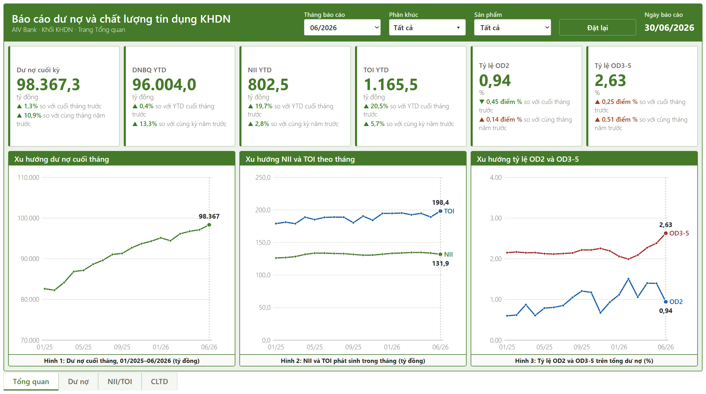
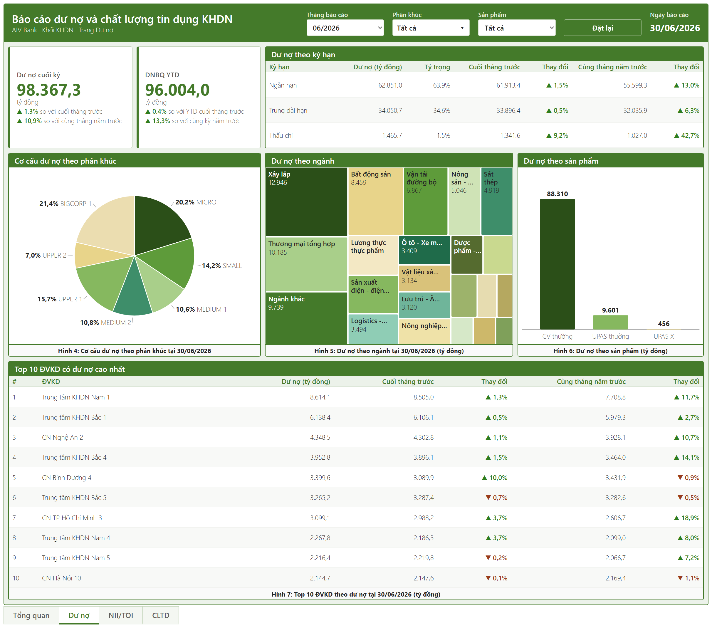
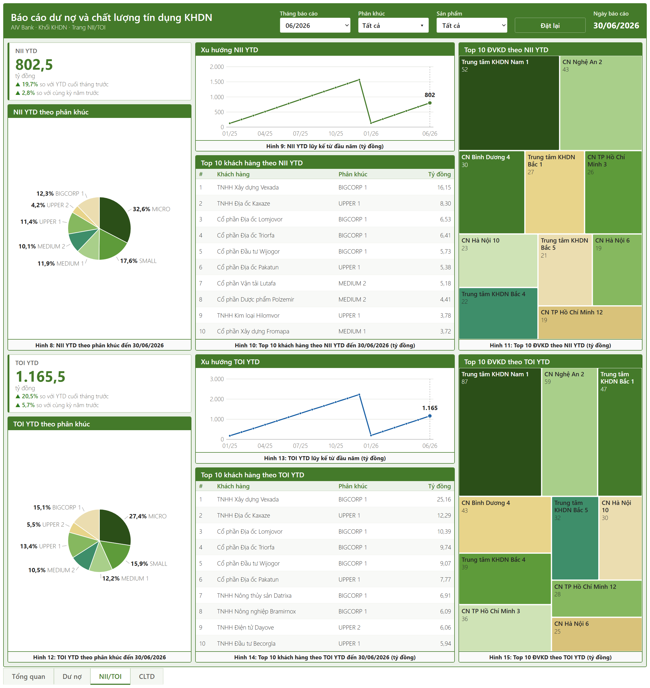
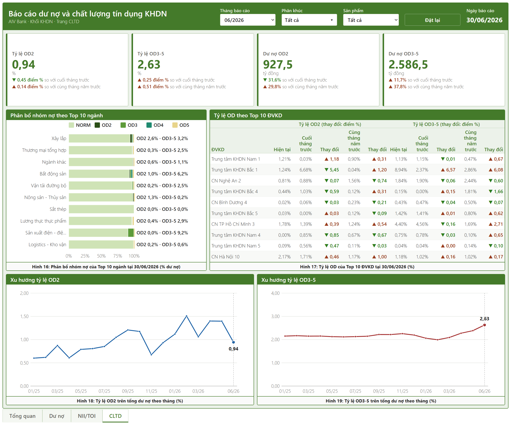

# Corporate Loan Portfolio Analytics | Power BI, DAX, Python

A loan balance and credit quality report for the corporate banking division (KHDN) of **AIV Bank**, a simulated Vietnamese bank. The report answers three questions a credit portfolio manager asks every month: *Where is loan growth coming from? Is income keeping up with it? Where is risk building up?*

> Course project for the eDA program (Module 2), AI VIET NAM. The bank, customers, and figures are synthetic. All amounts are in billion VND.



## Key numbers (30/06/2026)

| Metric | Value | Change |
|---|---|---|
| Outstanding loans | 98,367 bn | +1.3% MoM · **+10.9% YoY** |
| Average balance YTD | 96,004 bn | +13.3% YoY |
| Net interest income (NII) YTD | 802.5 bn | **+2.8% YoY** |
| Total operating income (TOI) YTD | 1,165.5 bn | +5.7% YoY |
| Special-mention loans (OD2) | 0.94% | −0.45 pt MoM |
| Net interest margin (NIM) YTD | 1.67% | −0.17 pt YoY |
| Bad debt (OD3–5) | **2.63%** | +0.25 pt MoM · +0.51 pt YoY |
| Customers with outstanding loans | 8,778 | −140 YoY |

### Glossary

| Term | Meaning | How it is calculated |
|---|---|---|
| Outstanding loans | What customers owe at a month-end date | Balance at one date, never summed across months |
| NII | Net interest income | Interest earned − funding cost (FTP), summed over the period |
| NFI | Net fee income | Fees earned − fees paid, summed over the period |
| TOI | Total operating income | NII + NFI |
| NIM | Net interest margin: interest earned per unit of loans per year | NII ÷ average balance, annualised (H1/2026: 802.5 ÷ 96,004 × 2 = 1.67%) |
| OD2 / OD3–5 | Special-mention / bad debt ratio | Debt group 2 (or 3–5) balance ÷ total balance |

## Key findings

The main issue in H1/2026 is **the quality of growth, not its size**: loans grew by double digits, but NII barely moved.

1. **Growth comes from existing customers; the customer base keeps shrinking.** Customers with outstanding loans fell 4.4% (9,180 → 8,778) and shrank in all 10 quarters (820 gained, 1,222 lost). The average balance per customer rose 48% (7.57 → 11.21 bn).
2. **NIM fell 0.17 pt because margins narrowed, not because the mix shifted.** A mix/rate decomposition puts the mix effect at only −0.01 to −0.02 pt by segment, term or currency. Two new incentive programmes (CT0701, CT0801; 11.5% of average balance) account for −0.10 pt, and non-incentive short-term VND loans for another −0.09 pt (NIM 2.06% → 1.83%).
3. **One loan distorts the June bad-debt figure.** A single 390 bn loan moved to debt group 3, lifting OD3–5 from 2.38% to 2.63%. Excluding it, the ratio actually *fell* from 2.39% to 2.24%. The same loan explains the spikes in electronics (9.2% → 0.2% without it) and at Trung tâm KHDN Bắc 1.
4. **The underlying risk is in real estate.** Real estate bad debt doubled in 12 months (3.06% → 6.15%) with a NIM of only 1.00%, and 4 of the top 10 borrowers are real estate firms. Write-offs rose to 547 bn in H1/2026 from 217 bn, which keeps the headline ratio looking flat.
5. **Ratings separate risk well, but pricing does not follow.** OD3–5 rises steadily from A (0.38%) to CCC (8.09%), yet within the same segment the median rate between A and CCC differs by only 0.6–0.7 pt.
6. **Income is as concentrated as loans.** The top 20% of customers hold 80.8% of loans and generate 82.5% of TOI (Gini 0.77 and 0.75). Single-name risk is still low: the top 10 hold 9.8%. 346 customers have negative TOI (−73 bn), all with group 3–5 loans that no longer accrue interest.
7. **Early warning from the credit bureau.** 101 customers (825 bn, 0.84% of loans) are still group 1 internally but already group 2 at CIC.

**Suggested priorities:** review short-term VND pricing and the CT0801 programme; monitor real estate, starting with the 4 top-10 names; report bad debt with and without one-off large loans; use the CIC list as an early-warning feed; find out why customers leave and restore SMALL-segment margins (NII −11.5%).

**Limits:** the data is synthetic; the analysis is descriptive (correlation, not causation); there is no operating or credit cost data, so profit after provisions cannot be assessed.

## Dashboard

Four pages share one header with filters for **reporting month**, **customer segment**, and **product**. Every KPI card compares against the previous month-end and the same month last year.

| Page | Question | Contents |
|---|---|---|
| Tổng quan (Overview) | How is the portfolio doing overall? | 6 KPI cards; 18-month trends for loans, NII/TOI, and OD2 / OD3–5 ratios |
| Dư nợ (Loan balance) | Where does the loan book sit? | Balance by term, segment, industry (treemap), and product; top 10 business units |
| NII/TOI | Who generates the income? | NII and TOI YTD by segment, YTD trend, top 10 customers and top 10 business units |
| CLTD (Credit quality) | Where is risk building up? | OD2 / OD3–5 ratios and balances; debt group mix in the top 10 industries; OD ratios for the top 10 business units |

| Loan balance | NII/TOI | Credit quality |
|---|---|---|
|  |  |  |

An interactive HTML version of the same four pages is in [`dashboard/AIV_Bank_KHDN_Dashboard.html`](dashboard/AIV_Bank_KHDN_Dashboard.html). Download it and open it in a browser; it needs no Power BI license.

## Data model

The source is one Excel workbook with a star schema of 14 tables (about 723K rows): 10,000 corporate customers, 31,104 loan contracts, 78 business units, and month-end snapshots from 12/2023 to 06/2026.

- **Dimensions:** `dim_customer`, `dim_loan_contract`, `dim_branch`, `dim_segment`, `dim_industry`, `dim_product`, `dim_debt_group`, `dim_campaign`, `dim_date`
- **Facts:** `fact_loan_balance` (month-end balance per contract), `fact_income_monthly` (NII, NFI, TOI per contract and month), `fact_plan`, `fact_due_soon`, `fact_debt_group_cic`

Business rules built into the DAX measures:

- **Loan balance is a stock:** it is read at a single month-end date and never summed across months.
- **NII, NFI, and TOI are flows:** they are summed over the period (month or year to date).
- **Average balance YTD** = sum of monthly average balances from January ÷ number of months.
- **OD2 ratio** = debt group 2 balance ÷ total balance; **OD3–5 ratio** = debt groups 3–5 balance ÷ total balance.
- Every comparison uses the previous month-end (LM) and the same month last year (LY), so the whole report follows the reporting-month filter.

The semantic model holds 154 DAX measures, grouped into numbered display folders by business area (loan balance, income, credit quality, KPI cards, conditional colours, tables, Top 10, trends, titles); helper measures sit in a hidden `99 Trung gian` folder. The EDA behind the findings is in [`notebooks/eda_descriptive_khdn.ipynb`](notebooks/eda_descriptive_khdn.ipynb) (in Vietnamese): data checks, NIM mix/rate decomposition, bad debt under three definitions, distribution and concentration analysis, and segment, industry, region and rating breakdowns.

## Repository structure

```
├── dashboard/
│   ├── AIV Bank CLTD Dashboard.pbip            # open in Power BI Desktop
│   ├── AIV Bank CLTD Dashboard.Report/         # 4 report pages (PBIR)
│   ├── AIV Bank CLTD Dashboard.SemanticModel/  # tables, relationships, DAX (TMDL)
│   └── AIV_Bank_KHDN_Dashboard.html            # interactive HTML version
├── images/                                     # page screenshots
└── notebooks/
    └── eda_descriptive_khdn.ipynb              # EDA notebook (Vietnamese)
```

## How to open

1. Open `dashboard/AIV Bank CLTD Dashboard.pbip` in Power BI Desktop (with the PBIP and TMDL preview features turned on).
2. The dataset (`AIV_Bank_KHDN_Dataset.xlsx`) is course material and is not included. To refresh, place it locally and update the file path in each table's Power Query source.
3. To rerun the notebook, set `DATA` in its first code cell to the local path of the dataset.

## Tools

Power BI Desktop (PBIP, TMDL), DAX, Power Query, Python (pandas, numpy, matplotlib).
