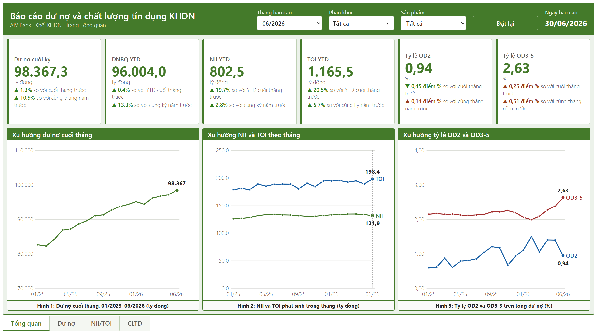
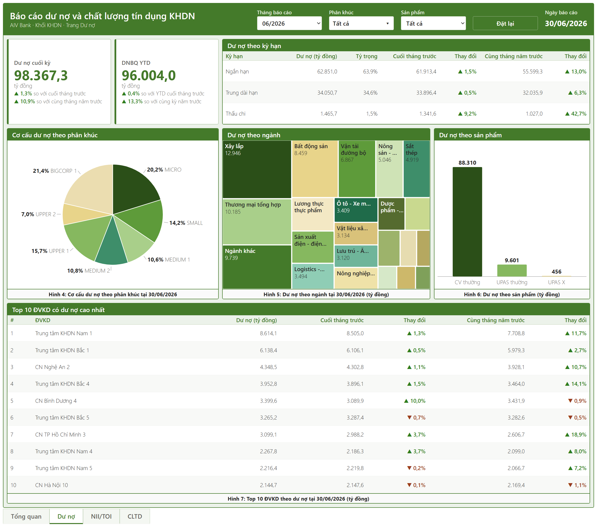
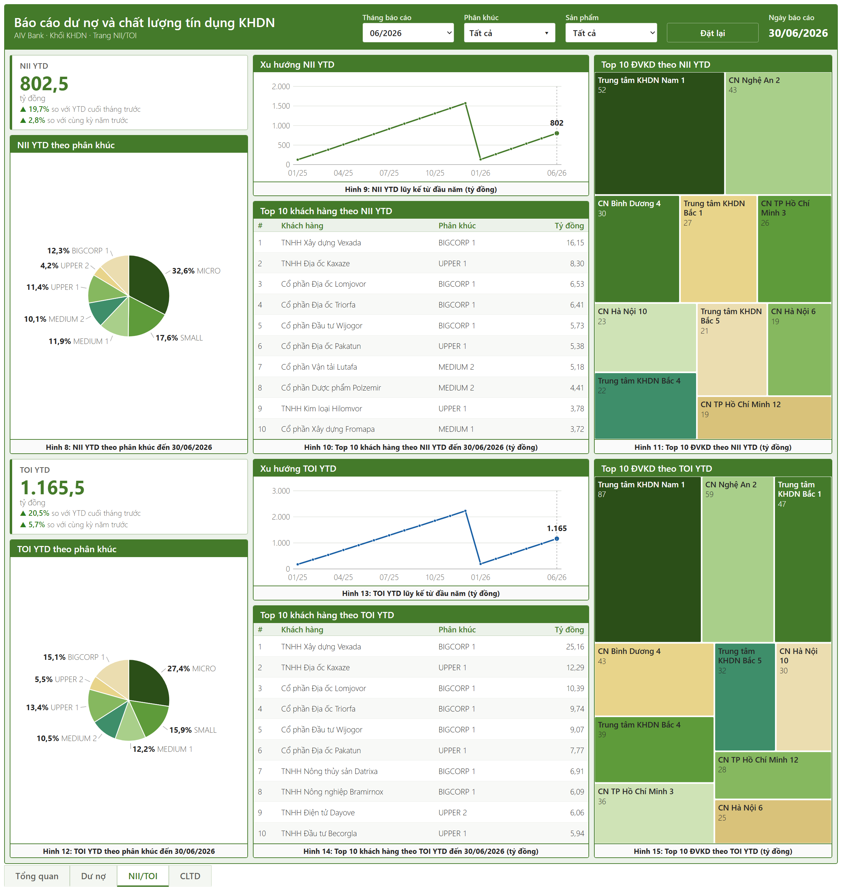
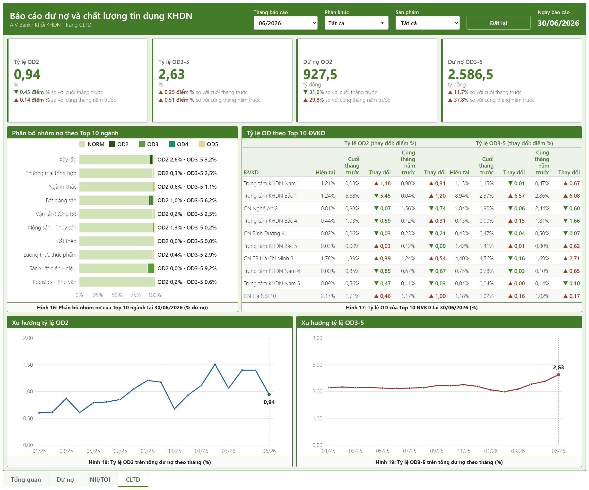

# Corporate Loan Portfolio Analytics | Power BI, DAX, Python

A loan balance and credit quality report for the corporate banking division (KHDN) of **AIV Bank**, a simulated Vietnamese bank. The report answers three questions a credit portfolio manager asks every month: *Where is loan growth coming from? Is income keeping up with it? Where is risk building up?*

> Course project for the eDA program (Module 2), AI VIET NAM. The bank, customers, and figures are synthetic. All amounts are in billion VND.



## Key numbers (30/06/2026)

| Metric | Value | Change |
|---|---|---|
| Outstanding loans | 98,367 bn | +1.3% MoM · **+10.9% YoY** |
| Average balance YTD | 96,004 bn | +13.3% YoY |
| Net interest income (NII) YTD | 802.5 bn | **+2.8% YoY** |
| Total operating income (TOI) YTD | 1,165.5 bn | +5.7% YoY |
| Special-mention loans (OD2) | 0.94% | −0.45 pt MoM |
| Bad debt (OD3–5) | **2.63%** | +0.25 pt MoM · +0.51 pt YoY |

## Key findings

1. **The loan book grows, but margins are thinning.** Loans rose 10.9% year on year and the average balance 13.3%, yet NII grew only 2.8%. Monthly NII has stayed flat at about 132–135 bn through 2026, so the net interest margin slipped from about 1.9% to 1.7%.
2. **Growth is shifting toward large clients.** MICRO and SMALL firms are 83.5% of borrowers but hold 34.4% of loans (down from 40.8% in 12/2023). UPPER and BIGCORP clients, 6.1% of borrowers, now hold 44.1%. The top 10% of borrowers hold 68% of the book (Gini 0.77).
3. **Bad debt has turned up.** The OD3–5 ratio held at 2.1–2.2% through 2025, then rose four months in a row from 1.99% (01/2026) to 2.63%. OD3–5 balances are up 37.8% year on year.
4. **Risk is concentrated in a few places.** Bad debt is 9.2% in electrical and electronics manufacturing and 6.2% in real estate (vs 2.6% overall), and 4.1% on medium and long-term loans (vs 1.9% short-term). At branch level, Trung tâm KHDN Bắc 1 jumped from 2.37% to 8.94% OD3–5 in one month.
5. **Early warnings outside the bank.** Of the 573 customers that the national credit bureau (CIC) places in debt group 2 or worse, 124 (21.6%) are rated better by the bank itself, a sign they are already in trouble at other lenders, and 15% of OD2 loans fell into OD3 in June.

## Dashboard

Four pages share one header with filters for **reporting month**, **customer segment**, and **product**. Every KPI card compares against the previous month-end and the same month last year.

| Page | Question | Contents |
|---|---|---|
| Tổng quan (Overview) | How is the portfolio doing overall? | 6 KPI cards; 18-month trends for loans, NII/TOI, and OD2 / OD3–5 ratios |
| Dư nợ (Loan balance) | Where does the loan book sit? | Balance by term, segment, industry (treemap), and product; top 10 business units |
| NII/TOI | Who generates the income? | NII and TOI YTD by segment, YTD trend, top 10 customers and top 10 business units |
| CLTD (Credit quality) | Where is risk building up? | OD2 / OD3–5 ratios and balances; debt group mix in the top 10 industries; OD ratios for the top 10 business units |

| Loan balance | NII/TOI | Credit quality |
|---|---|---|
|  |  |  |

An interactive HTML version of the same four pages is in [`dashboard/AIV_Bank_KHDN_Dashboard.html`](dashboard/AIV_Bank_KHDN_Dashboard.html). Download it and open it in a browser; it needs no Power BI license.

## Data model

The source is one Excel workbook with a star schema of 14 tables (about 723K rows): 10,000 corporate customers, 31,104 loan contracts, 78 business units, and month-end snapshots from 12/2023 to 06/2026.

- **Dimensions:** `dim_customer`, `dim_loan_contract`, `dim_branch`, `dim_segment`, `dim_industry`, `dim_product`, `dim_debt_group`, `dim_campaign`, `dim_date`
- **Facts:** `fact_loan_balance` (month-end balance per contract), `fact_income_monthly` (NII, NFI, TOI per contract and month), `fact_plan`, `fact_due_soon`, `fact_debt_group_cic`

Business rules built into the DAX measures:

- **Loan balance is a stock:** it is read at a single month-end date and never summed across months.
- **NII, NFI, and TOI are flows:** they are summed over the period (month or year to date).
- **Average balance YTD** = sum of monthly average balances from January ÷ number of months.
- **OD2 ratio** = debt group 2 balance ÷ total balance; **OD3–5 ratio** = debt groups 3–5 balance ÷ total balance.
- Every comparison uses the previous month-end (LM) and the same month last year (LY), so the whole report follows the reporting-month filter.

The semantic model holds 170 DAX measures. The EDA behind the findings is in [`notebooks/eda_descriptive_khdn.ipynb`](notebooks/eda_descriptive_khdn.ipynb) (in Vietnamese).

## Repository structure

```
├── dashboard/
│   ├── AIV Bank CLTD Dashboard.pbip            # open in Power BI Desktop
│   ├── AIV Bank CLTD Dashboard.Report/         # 4 report pages (PBIR)
│   ├── AIV Bank CLTD Dashboard.SemanticModel/  # tables, relationships, DAX (TMDL)
│   └── AIV_Bank_KHDN_Dashboard.html            # interactive HTML version
├── images/                                     # page screenshots
└── notebooks/
    └── eda_descriptive_khdn.ipynb              # descriptive EDA with comments
```

## How to open

1. Open `dashboard/AIV Bank CLTD Dashboard.pbip` in Power BI Desktop (with the PBIP and TMDL preview features turned on).
2. The dataset (`AIV_Bank_KHDN_Dataset.xlsx`) is course material and is not included. To refresh, place it locally and update the file path in each table's Power Query source.

## Tools

Power BI Desktop (PBIP, TMDL), DAX, Power Query, Python (pandas, matplotlib).
